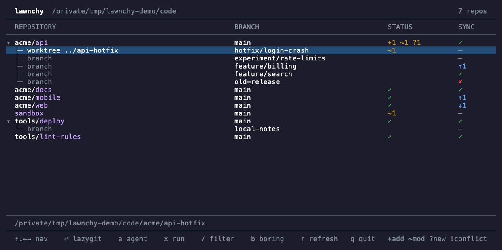

# lawnchy

[](https://github.com/nicbet/lawnchy/actions/workflows/ci.yml)
[](LICENSE)

**Sit back, watch your repos, launch anything.**

A terminal dashboard for every git repo on your machine. Point lawnchy at a folder and see what needs attention across all your projects: uncommitted changes, unpushed commits, forgotten worktrees and branches whose upstream has vanished. Then jump straight into any of them: [lazygit](https://github.com/jesseduffield/lazygit) with Enter, your coding agent with `a`, or any tool you like with `x`.


## Get started

```bash
curl -fsSL https://github.com/nicbet/lawnchy/releases/latest/download/lawnchy-darwin-arm64.tar.gz | tar -xz lawnchy
sudo mv lawnchy /usr/local/bin/
lawnchy ~/code
```

That's the Apple Silicon build. See [Installation](#installation) for Linux and building from source.

## Why lawnchy

**See everything at once.** `git status` answers for one repo. lawnchy answers for all of them, including the worktrees and branches `git status` doesn't mention.

**Quiet repos stay out of your way.** Press `b` to hide everything with nothing to act on. What's left is your to-do list.

**The trunk comes first.** Each repo's row is always `main` or `master`, wherever it's checked out. Everything else sits underneath, so a directory left on a feature branch is obvious.

**Safe to leave running.** lawnchy only reads. It never fetches, and it won't take `index.lock` away from the git commands you're running yourself.

**Built for the real world.** Deleted worktrees, broken `.git` folders and repos with no commits each get an honest status, and one bad repo doesn't affect the rest.

**From seeing to doing in one key.** Launch lazygit, a coding agent, your editor, a shell or anything else in the exact folder you're looking at, then land back where you were.

**A single binary.** No runtime to install, just `git`. Everything else is optional.

## Reading the screen



Each folder containing a `.git` directory gets a row showing its trunk. Below it are the things that row doesn't cover:

- **Worktrees:** every other checkout, each with its own changes and sync state. `worktree .` means the repo's own directory is on a non-trunk branch.
- **Branches:** other local branches that aren't checked out anywhere.

**Status** is about your working tree:

| Shown | Meaning |
| --- | --- |
| `✓` | No changes |
| `+2` | Staged files |
| `~3` | Modified files |
| `?1` | Untracked files |
| `!1` | Conflicted files |
| *(blank)* | Not checked out, so there's no working tree |
| `✗ missing` | The worktree's directory has been deleted |
| `✗ error` | git couldn't read it; select the row to see why |
| `bare` | A bare repository with no working tree |

**Sync** is about your upstream, as of your last fetch:

| Shown | Meaning |
| --- | --- |
| `✓` | Matches its upstream |
| `↑2 ↓1` | 2 commits ahead, 1 behind |
| `—` | No upstream, so nothing to compare against |
| `✗` | Its upstream branch has been deleted |

Selecting a row with `✗` spells out the state on the detail line.

## Keys

| Key | Action |
| --- | --- |
| `↑` `↓` or `k` `j` | Move |
| `PgUp` `PgDn` `Home` `End` | Jump |
| `←` or `h` | Fold a repo, or go from a sub-row to its repo |
| `→` or `l` | Unfold |
| `Space` | Toggle fold |
| `Enter` or `o` | Open the highlighted row in lazygit |
| `a` | Run your default agent there, or choose one if there's no default |
| `A` | Choose an agent |
| `x` | Open the launch dialog |
| `/` | Filter repos |
| `Esc` | Clear the filter |
| `b` | Hide or show boring repos |
| `r` | Rescan and refresh |
| `q` or `Ctrl+C` | Quit |

### Filtering

Press `/` and type. The list narrows as you go, matching the repo's path as listed. The text is a case-insensitive regular expression such as `^acme/.*api$`, or a plain string if it isn't valid regex, like `c++`. `Enter` keeps the filter and `Esc` clears it.

### Boring repos

Press `b` to hide a repo when all of these are true:

- Its trunk has no changes, and isn't ahead of, behind or missing its upstream
- It has no other checkouts
- No other branch is ahead of, behind or missing its upstream

A trunk or branch with no upstream at all doesn't count against a repo. Repos still loading or showing an error are never hidden. Filtering and boring mode combine: a repo must match and not be boring.

### Opening lazygit

`Enter` or `o` hands the terminal to lazygit. Quit it and you're back where you were, refreshed. Agents and launchables work the same way.

Every launch runs in the highlighted row's folder:

| Row | Runs in |
| --- | --- |
| Repo | Wherever the trunk is checked out |
| Worktree | That worktree |
| Branch | The repo |

Rows showing `✗ error` or `✗ missing` don't launch anything.

### Coding agents

Press `a` to run your default agent in the highlighted folder. With no default set, a picker lists any installed well-known agents (Claude Code, Codex, Gemini, opencode, Aider, Cursor Agent, Amp and Goose) plus your own. `A` always opens the picker, and `d` in the picker saves the highlighted agent as your default.

### The launch dialog

Press `x`, then a single key, to launch anything. `x` then `t` opens a shell in that folder, which works with no setup. Add your own in the config file:

```toml
[launchables]
code = { key = "c", command = "code ." }
xpo = { key = "x", command = "xpo board" }
yazi = { key = "y", command = "yazi" }
```

Keys are case-sensitive, so `c` and `C` can launch different things. The built-in `terminal` steps aside if you define an entry with that name or use `t` yourself.

### Knowing you're inside lawnchy

A launched program can look just like a regular terminal, so lawnchy marks it in three ways:

- **A message above the program** says what's running and how to get back. Full-screen programs cover it.
- **The terminal title** becomes `lawnchy ▸ xpo`, if your terminal or multiplexer shows titles, and is restored when you return.
- **The `LAWNCHY` environment variable** is set to `1`, so your shell prompt can show it. For bash or zsh, add this to the end of your `.bashrc` or `.zshrc`:

  ```bash
  [ -n "$LAWNCHY" ] && PS1="(lawnchy) $PS1"
  ```

## Configuration

lawnchy works without a config file. To add agents or launchables, create `~/.config/lawnchy/config.toml`, or `$XDG_CONFIG_HOME/lawnchy/config.toml` if you've set that variable. Changes apply the next time you press the key.

```toml
# Used by `a`. Can be an [agents] entry or any command on your PATH.
default_agent = "claude"

# Shown in the agent picker, alongside any installed well-known agents.
[agents]
claude = "claude --continue"
review = "codex --model o4"

# Shown in the `x` dialog, in this order.
[launchables]
code = { key = "c", command = "code ." }
terminal = { key = "s", command = "fish" }
```

Commands run through `sh` in the row's folder, so they can use arguments and variables like `$SHELL`. Shell aliases and functions aren't available. If the config has a problem, lawnchy says so at the bottom of the screen and keeps working with whatever is valid.

## Installation

### Requirements

- macOS on Apple Silicon, or Linux with glibc on x64 or arm64
- Git 2.36 or newer
- [lazygit](https://github.com/jesseduffield/lazygit), only for `Enter`
- A terminal with truecolor support

### Binary download

Pick your platform, then put the binary on your `PATH`:

```bash
# macOS (Apple Silicon)
curl -fsSL https://github.com/nicbet/lawnchy/releases/latest/download/lawnchy-darwin-arm64.tar.gz | tar -xz lawnchy

# Linux (x64)
curl -fsSL https://github.com/nicbet/lawnchy/releases/latest/download/lawnchy-linux-x64.tar.gz | tar -xz lawnchy

# Linux (arm64)
curl -fsSL https://github.com/nicbet/lawnchy/releases/latest/download/lawnchy-linux-arm64.tar.gz | tar -xz lawnchy

sudo mv lawnchy /usr/local/bin/
```

Each [release](https://github.com/nicbet/lawnchy/releases) includes a `checksums.txt`. Binaries aren't notarized, so on macOS a copy downloaded through a browser may be blocked by Gatekeeper. The `curl` commands above avoid that.

### From source

Requires [Bun](https://bun.sh) 1.3.14 or newer.

```bash
git clone https://github.com/nicbet/lawnchy.git
cd lawnchy
make build
sudo make install
```

To install without `sudo`, use `make install PREFIX=~/.local`, and make sure `~/.local/bin` is on your `PATH`. `make uninstall` removes it.

## Good to know

- **Statuses update when you ask.** Press `r` to refresh. lawnchy also refreshes after you quit lazygit, but doesn't poll on a timer.
- **It never fetches.** Ahead and behind counts are only as fresh as your last `git fetch`.
- **The scan stops at each repo.** A repo nested inside another repo isn't listed, and neither are submodules. `node_modules`, `__pycache__` and `.venv` are skipped, and symlinks aren't followed.
- **The trunk is always `main` or `master`.** If a repo has neither, its row shows the current checkout instead.
- **Scanning runs git in every repo it finds.** See [SECURITY.md](SECURITY.md) before pointing it at repositories you don't trust.

## Contributing

Bug reports and pull requests are welcome. See [CONTRIBUTING.md](CONTRIBUTING.md) to get set up.

## License

[MIT](LICENSE)

Built with [OpenTUI](https://github.com/anomalyco/opentui).
